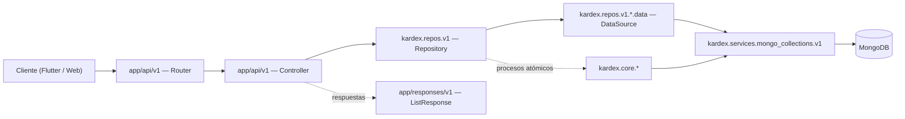
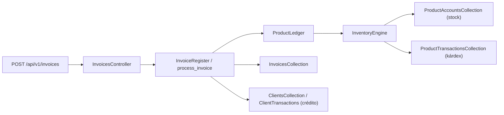

# Arquitectura (`kardex-server`)

Documento de referencia sobre **cómo está organizado el backend y cómo fluye una petición**. Para el mapa de módulos concretos, ver [`modules/INDEX.md`](./modules/INDEX.md). Para reglas de código, [`conventions.md`](./conventions.md).

---

## 1. Principio central

`kardex-server` implementa **Onion Architecture (Clean Architecture)** estricta. La dependencia siempre apunta hacia adentro:

```text
Router → Controller → Repository → DataSource → MongoCollection
```

- El **router** valida HTTP y expone endpoints.
- El **controller** orquesta casos de uso y arma respuestas.
- El **repository** contiene reglas de negocio y validaciones de dominio.
- El **datasource** traduce el dominio a consultas de persistencia.
- La **collection** encapsula el acceso a una colección de MongoDB.

**Nunca** se salta una capa ni se invierte la flecha. Si ves lógica de negocio en un controller, está mal ubicada.

---

## 2. Capas y responsabilidades

> En este documento, `kardex/...` es abreviatura de `packages/kardex-business/src/kardex/...`.

| Capa | Ubicación | Responsabilidad | Prohibido |
| :--- | :--- | :--- | :--- |
| Router | `app/api/v1/<modulo>/<modulo>_router.py` | Declarar endpoints, dependencias y códigos HTTP. | Lógica de negocio, consultas a Mongo. |
| Controller | `app/api/v1/<modulo>/<modulo>_controller.py` | Orquestar repos/procesos, mapear a `ListResponse`/modelos de respuesta. | Reglas de negocio complejas. |
| Repository | `kardex/repos/v1/<entidad>/<entidad>_repository.py` | Reglas de negocio, validaciones, singleton. | Depender de FastAPI. |
| DataSource | `kardex/repos/v1/<entidad>/data/<entidad>_datasource.py` | Consultas y escrituras concretas. | Reglas de negocio. |
| Collection | `kardex/services/mongo_collections/v1/<entidad>_collection.py` | Operaciones Mongo de una colección (`collection_name`). | Orquestación entre entidades. |
| Procesos | `kardex/core/<proceso>/` | Operaciones atómicas que cruzan varias entidades. | Exponer HTTP. |
| Tools | `kardex/tools/` | Utilidades transversales (tiempo, UUID, ETag, búsqueda, settings). | Estado de request. |
| Web local | `app/` | FastAPI, middleware, scheduler, servicios externos. | Lógica de dominio reutilizable. |

> El paquete `packages/kardex-business` **no puede importar FastAPI**. Si necesitas `HTTPException`, estás en la capa equivocada: lanza una `KardexException` y deja que `app/regis_exception_handlers.py` la traduzca.

---

## 3. Diagrama



---

## 4. Flujo de una petición (ejemplo)

```text
POST /api/v1/products
  → app/api/v1/products/products_router.py        (valida body con CreateProduct)
  → app/api/v1/products/products_controller.py    (orquesta)
  → kardex/repos/v1/products/products_repository.py (reglas + singleton)
  → kardex/repos/v1/products/data/products_datasource.py
  → kardex/services/mongo_collections/v1/products_collection.py
  → MongoDB (Products)
```

Para operaciones que tocan varias entidades (facturar, transferir, aprobar un ajuste), el controller llama a un proceso de `kardex/core/` que coordina las colecciones de forma atómica.

---

## 5. Árbol de carpetas

```text
kardex-server/
├── app/                                  # Capa web (FastAPI)
│   ├── main.py                           # FastAPI app + CORS + router v1
│   ├── app_lifespan.py                   # init_services + scheduler
│   ├── regis_exception_handlers.py       # KardexException -> HTTP
│   ├── api/v1/<modulo>/                  # <modulo>_router.py + <modulo>_controller.py
│   ├── responses/v1/list_response.py     # ListResponse[T]
│   ├── params/pagination_params.py
│   ├── app_middleware/depends/           # auth, api-key, tenant, cache headers
│   ├── core/scheduler/                   # tareas programadas + recordatorios
│   ├── core/app_notifier/
│   ├── core/services_initializer.py      # datos semilla al arrancar
│   ├── services/                         # excel_service, telgram_service
│   └── repos/v1/                         # VACÍO (residuo de plantilla; no usar)
├── packages/kardex-business/src/kardex/  # Dominio puro (sin FastAPI)
│   ├── repos/v1/<entidad>/               # repository + data/ + models/
│   ├── repos/v1/common/                  # filter_params y modelos compartidos
│   ├── core/<proceso>/                   # procesos de negocio atómicos
│   ├── services/mongo_collections/v1/    # una colección por archivo
│   ├── services/mongo_indexes.py
│   ├── tools/                            # TimeTools, UuidTool, EtagTool, etc.
│   ├── lite/core/                        # variantes de la edición Lite
│   └── kardex_config.py                  # KardexConfig + kardexCtx
├── test/                                 # pytest
├── wiki/                                 # documentación
├── app/config/onion-config.toml          # registro de colecciones
└── Dockerfile
```

> **`app/repos/v1/` está vacío.** Es un residuo de la plantilla Onion. No agregues lógica ahí: todo vive en `packages/kardex-business/src/kardex/repos/v1/`.

---

## 6. Multi-tenant y contexto de sucursal

Cada request publica un contexto en un `ContextVar`:

```python
@dataclass
class KardexContext:
    businessNickname: str = ""
    branchId: str = ""

kardexCtx = contextvars.ContextVar("kardexCtx", default=KardexContext())
```

| Header | Significado |
| :--- | :--- |
| `X-Servin` | Identificador de la sucursal activa |
| `x-tenant-nickname` | Alias del negocio/tenant |

Los repositorios y procesos leen `kardexCtx` para saber sobre qué sucursal operar. **No hardcodees `branchId`**: usa el header o el parámetro del endpoint.

El detalle de guards y routers protegidos está en [`security.md`](./security.md).

---

## 7. Flujos de negocio críticos

### 7.1 Facturación y descarga de stock



- La factura descuenta stock vía `inventory_engine` y registra movimientos en `ProductTransactions`.
- Si es a crédito, impacta `ClientTransactions` y el balance del cliente mediante `ClientFinanceEngine` (`kardex/core/finance/`).
- `KardexConfig.followTransaction` decide si el flujo formal de kárdex está activo.
- `KardexConfig.letInvoiceWithNegative` permite o bloquea facturar sin stock.

### 7.2 Notas de crédito

Estados: `emitted → approved → applied`, con `rejected` y `cancelled` como salidas.

- La **emisión** no toca stock ni transacciones de producto.
- La **aprobación** reingresa inventario si es por devolución y crea `ProductTransaction` con `subtype="credit_note"`.
- La **aplicación** en un recibo reduce la deuda y registra `ClientTransaction`.

Detalle completo: [`modules/credit_notes.md`](./modules/credit_notes.md).

### 7.3 Recibos de pago

`receipt_register/process_receipt.py` aplica notas de crédito **aprobadas**, registra `ClientTransaction` y baja la deuda de las facturas. `reverse_receipt.py` revierte la aplicación y devuelve la nota a `approved`.

### 7.4 Devoluciones legacy vs. notas de crédito

- `devolutions` es el flujo histórico (confirmación por separado).
- `credit_notes` es la evolución recomendada; soporta devolución por mercancía o saldo a favor por monto.
- `composite` consolida facturas pendientes + devoluciones activas + notas aprobadas para la pantalla de cobranza.

### 7.5 Ajustes de inventario

- `adjust_entries` / `adjust_exits`: movimientos directos de sobrante/faltante.
- `adjustment_requests`: flujo con aprobación (pipeline en `kardex/core/adjustment_requests/pipeline/`). Al aprobarse genera la entrada/salida por ajuste correspondiente.

### 7.6 Transferencias entre sucursales

`transfer_manager` gestiona salida, recepción y cancelación. La recepción impacta el stock de la sucursal destino; la cancelación revierte el documento.

### 7.7 Importaciones CSV

`POST /imports/preview` valida el archivo y devuelve totales/errores **sin escribir**. Luego `POST /imports/{init-inventory|inventory|clients|suppliers}` ejecuta la carga. El inventario inicial usa la sucursal virtual `0000-<branchId>`.

### 7.8 Scheduler y datos semilla

- `app/core/scheduler/app_scheduler.py` ejecuta recordatorios y reporte diario. **No arranca cuando `MODE=DEV`**.
- `app/core/services_initializer.py` crea roles, categorías de gasto, escalas, integración, app settings y usuario root al iniciar.

---

## 8. Modo Lite

`LITE_MODE=true` (o `LET_NEGATIVE`) ajusta `KardexConfig`:

| Bandera | `main` | `lite` |
| :--- | :--- | :--- |
| `letInvoiceWithNegative` | `false` | `true` |
| `followTransaction` | `true` | `false` |
| `createFullProductProfile` | `false` | `true` |

Las variantes de dominio exclusivas de Lite viven en `kardex/lite/core/`. Al implementar algo en `main`, evalúa explícitamente si aplica a Lite.

---

## 9. Dónde NO va el código

| Si vas a… | No lo pongas en… | Ponlo en… |
| :--- | :--- | :--- |
| Consultar Mongo | Controller | `repos/.../data/` o `services/mongo_collections/` |
| Validar reglas de negocio | Router | `repos/..._repository.py` o `core/` |
| Levantar `HTTPException` | Paquete `kardex-business` | `KardexException` + `app/regis_exception_handlers.py` |
| Coordinar varias entidades | Un datasource | `kardex/core/<proceso>/` |
| Agregar una colección | Hardcodear el nombre | `mongo_collections/v1/` + `onion-config.toml` |
