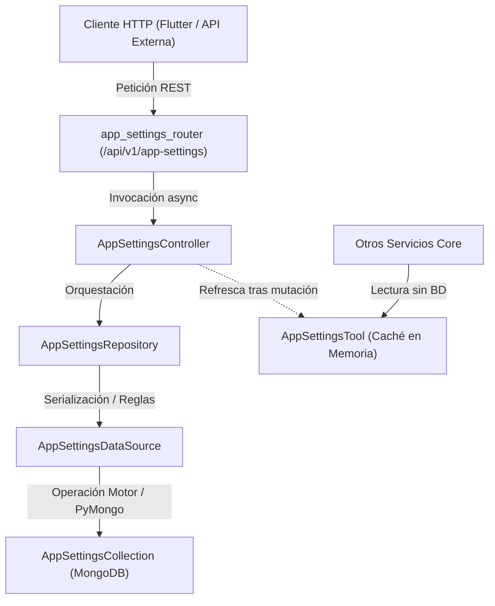

# Documentación del Módulo: Configuraciones Globales (`app_settings`)

El módulo **Configuraciones Globales (`app_settings`)** centraliza y administra los parámetros operativos, comerciales y logísticos que rigen el comportamiento del sistema `kardex-server`.

---

## 1. Arquitectura y Flujo de Datos (Onion Architecture)

El módulo sigue la arquitectura desacoplada estricta del backend:

---

## 2. Componentes del Módulo

### 2.1. Colección MongoDB (`AppSettings`)
- **Archivo:** `packages/kardex-business/src/kardex/services/mongo_collections/v1/app_settings_collection.py`
- **Nombre de colección:** `"AppSettings"`
- **Operaciones:**
  - `create_app_setting(dict)`: Inserción directa.
  - `create_app_setting_if_absent(dict)`: Inserción atómica con `find_one_and_update(..., upsert=True)`.
  - `fetch_all_app_settings()`: Obtiene todos los documentos.
  - `fetch_app_setting_by_id(id)`: Búsqueda por `id`.
  - `update_app_setting_by_id(id, dict)`: Actualización con retorno del documento posterior a la modificación (`ReturnDocument.AFTER`).
  - `delete_app_setting_by_id(id)`: Eliminación por `id`.

---

### 2.2. Modelos Pydantic v2
- **Archivo:** `packages/kardex-business/src/kardex/repos/v1/app_settings/models/app_setting_model.py`

| Campo | Tipo | Valor por Defecto | Descripción |
| :--- | :--- | :--- | :--- |
| `id` | `str` | `"Default"` | Identificador único del registro de configuración. |
| `useDefaultProfitMargin` | `bool` | `False` | Indica si el sistema debe aplicar/sugerir automáticamente el margen por defecto. |
| `defaultProfitMargin` | `float` | `20.0` | Porcentaje de margen de ganancia comercial por defecto (ej. 20%). |
| `useExpirationDates` | `bool` | `True` | Activa o desactiva el seguimiento de lotes y fechas de vencimiento. |
| `useOrders` | `bool` | `True` | Habilita el módulo comercial de órdenes de compra/venta. |
| `useQuotations` | `bool` | `True` | Habilita el módulo de cotizaciones y presupuestos/proformas. |
| `allowNegativeStock` | `bool` | `False` | Permite o bloquea facturación de productos sin existencias en sucursal. |
| `alertMinStock` | `bool` | `True` | Activa alertas de inventario mínimo o crítico. |
| `defaultPaymentTermDays` | `int` | `30` | Plazo predeterminado en días para facturas a crédito. |
| `useHoldSales` | `bool` | `True` | Permite pausar y reanudar ventas pendientes (ventas en espera). |
| `useQuickProductSearch` | `bool` | `False` | Abre el buscador rápido con botones de agregar y quitar cantidad al agregar productos en móvil (facturas, órdenes y cotizaciones). |
| `currency` | `Literal["NIO", "USD", "HNL", "GTQ", "CRC", "COP", "MXN", "EUR"]` | `"NIO"` | Moneda global del sistema. Define el símbolo visual usado en la app, tickets y reportes. No realiza conversión de montos. |
| `secondaryCurrency` | `Literal["NIO", "USD", "HNL", "GTQ", "CRC", "COP", "MXN", "EUR"]` | `"USD"` | Moneda secundaria informativa del sistema. Se muestra junto a la moneda principal; no convierte montos ni modifica cálculos. |
| `exchangeRate` | `float` | `0.0` | Tasa de cambio informativa: 1 unidad de la moneda secundaria equivale a `exchangeRate` unidades de la moneda principal. Debe ser mayor o igual a 0. |
| `showInvoiceTotalInSecondaryCurrency` | `bool` | `False` | Muestra el total equivalente en la moneda secundaria debajo del total final en el visor, ticket térmico y PDF A4 de facturas. |
| `showInvoiceItemsSummary` | `bool` | `False` | Muestra el resumen de total de ítems y total de cantidad en el visor, ticket térmico y PDF A4 de facturas. |
| `showInvoiceOrderCreator` | `bool` | `False` | Muestra el nombre de quien creó la orden o cotización de origen en el visor, ticket térmico y PDF A4 de facturas. |
| `chargeConvertedOrdersToShift` | `bool` | `False` | Cuando `useShifts` está activo, si el usuario tiene un turno abierto en la sucursal de la orden o cotización, la factura se carga a su caja. Si no tiene turno activo y `requireShiftForConvertedOrders` está desactivado, factura sin asignar turno. |
| `requireShiftForConvertedOrders` | `bool` | `False` | Cuando `useShifts` y `chargeConvertedOrdersToShift` están activos, exige un turno abierto en la sucursal para convertir una orden o cotización a factura; si no hay turno, la conversión se bloquea. |
| `allowCancellationsOutsideShift` | `bool` | `False` | Permite crear y aprobar solicitudes de anulación de facturas y recibos pertenecientes a un turno ya cerrado. No omite las demás validaciones (devoluciones, notas de crédito, abonos o estado del documento); los arqueos cerrados conservan sus totales guardados. |
| `roundUpInvoiceTotals` | `bool` | `False` | Redondea el subtotal de cada línea hacia arriba y los descuentos hacia abajo para que subtotal y total queden en unidades enteras de la moneda. Solo aplica a facturas nuevas (directas, anónimas y conversiones); no modifica órdenes, cotizaciones ni facturas existentes. |
| `companyLogoUrl` | `str \| None` | `None` | URL pública de la imagen corporativa global de la empresa. Es un parámetro solo estético usado en el home y el selector de sucursales; no se usa en documentos, reportes ni cálculos. |
| `createdAt` | `int` | Unix ms | Fecha y hora de creación en milisegundos. |
| `updatedAt` | `int \| None` | `None` | Fecha y hora de última actualización en milisegundos. |

- **Modelos disponibles:**
  - `BaseAppSetting`: Atributos comunes.
  - `CreateAppSetting`: Modelo de creación con `id: "Default"`.
  - `UpdateAppSetting`: Modelo de actualización parcial (`PATCH`) con todos los campos opcionales (`None`).
  - `AppSettingInDb`: Entidad persistida en MongoDB con sellos de tiempo.

---

### 2.3. Repositorio y Fuente de Datos
- **Fuente de Datos:** `packages/kardex-business/src/kardex/repos/v1/app_settings/data/app_settings_datasource.py`
  - Puente directo con `AppSettingsCollection.get_instance()`.
- **Repositorio:** `packages/kardex-business/src/kardex/repos/v1/app_settings/app_settings_repository.py`
  - Implementa el patrón Singleton `get_instance()`.
  - Provee `get_current_app_settings()`: Obtiene el registro `"Default"` o lo crea automáticamente al vuelo si la base de datos está vacía.
  - `update_app_setting_by_id()`: Aplica `model_dump(exclude_unset=True)` e inyecta la marca de tiempo `updatedAt = TimeTools.get_now_in_milliseconds()`.

---

### 2.4. Herramienta Singleton en Memoria (`AppSettingsTool`)
- **Archivo:** `packages/kardex-business/src/kardex/tools/app_settings_tool.py`
- **Propósito:** Mantener en la memoria del proceso del servidor una copia en caliente de `AppSettingInDb` para permitir lecturas sin costo de acceso a MongoDB.
- **Métodos:**
  - `get_current_app_settings() -> AppSettingInDb`: Retorna la configuración en caché (la consulta a la base de datos sólo si está vacía).
  - `refresh_current_app_settings() -> None`: Recarga forzosamente la configuración activa desde la base de datos (se ejecuta automáticamente tras cualquier `PATCH` o `DELETE`).

---

### 2.5. Inicialización en el Arranque (`Lifespan`)
- **Función:** `create_default_app_settings()` en `packages/kardex-business/src/kardex/core/default_values/create_default_app_settings.py`.
- **Ejecución:** En `app/core/services_initializer.py`, durante el arranque de FastAPI (`lifespan` en `app_lifespan.py`).
- Si la colección `AppSettings` no contiene el registro `"Default"`, se inicializa atómicamente con los valores por defecto del sistema.

---

## 3. Endpoints REST (`/api/v1/app-settings`)

Controlador: `app/api/v1/app_settings/app_settings_controller.py`  
Router: `app/api/v1/app_settings/app_settings_router.py`

| Método | Endpoint | Respuesta | Descripción |
| :--- | :--- | :--- | :--- |
| `GET` | `/api/v1/app-settings/current` | `AppSettingInDb` | Retorna la configuración activa actual desde el caché en memoria de `AppSettingsTool`. |
| `GET` | `/api/v1/app-settings` | `ListResponse[AppSettingInDb]` | Lista todas las configuraciones registradas. |
| `GET` | `/api/v1/app-settings/{id}` | `AppSettingInDb` | Consulta la configuración por identificador (ej. `"Default"`). Retorna 404 si no existe. |
| `POST` | `/api/v1/app-settings` | `AppSettingInDb` | Crea un nuevo registro de configuración a partir de `CreateAppSetting`. |
| `PATCH` | `/api/v1/app-settings/{id}` | `AppSettingInDb` | Actualiza parcialmente campos mediante `UpdateAppSetting`, sella `updatedAt` y refresca el caché de `AppSettingsTool`. |
| `DELETE` | `/api/v1/app-settings/{id}` | `AppSettingInDb` | Elimina la configuración por `id` y refresca el caché. |

---

## 4. Reglas de negocio: conversión de órdenes/cotizaciones a factura con turnos

Aplica al endpoint `POST /api/v1/orders/make-invoice/{order_id}`, usado tanto para **órdenes** como para **cotizaciones**. Las banderas se evalúan en cascada:

| `useShifts` | `chargeConvertedOrdersToShift` | `requireShiftForConvertedOrders` | Resultado |
| :---: | :---: | :---: | :--- |
| `false` | cualquiera | cualquiera | La conversión no interactúa con turnos; la factura se guarda con `shiftId = null`. |
| `true` | `false` | cualquiera | La conversión **no se carga al turno**, aunque el cajero tenga uno abierto. El frontend no envía `shiftId` y el backend lo descarta. |
| `true` | `true` | `false` | Si el cajero tiene un turno abierto en la sucursal de la orden/cotización, la factura se carga a ese turno. Si no tiene turno, se factura con `shiftId = null`. |
| `true` | `true` | `true` | Se exige un turno abierto en la sucursal. Si no existe, el frontend ofrece abrirlo y cancela la conversión si el usuario no lo abre; el backend rechaza la petición con HTTP 400 si llega sin `shiftId`. |

- **Valores por defecto:** las tres banderas son `false`.
- **Precedencia:** `requireShiftForConvertedOrders` solo tiene efecto cuando `useShifts` y `chargeConvertedOrdersToShift` están activos.
- **Implementación frontend:** `ShiftGuard.ensureShiftReady` y `ShiftCubit` en las pantallas de facturación de órdenes (`current_orders`) y cotizaciones (`current_proforma`).
- **Implementación backend:** `AppSettingsPolicy.converted_order_shift_policy` centraliza la tabla de verdad (`NEVER`/`OPTIONAL`/`REQUIRED`); `OrdersController.convert_order_to_invoice` la consume y `InvoiceRegister`/`validate_shift_link` validan que el turno exista, esté `open` y sea de la misma sucursal.
- **Alcance:** esta excepción aplica solo a la conversión de órdenes y cotizaciones. La facturación directa desde terminal de venta mantiene su propia validación de turno.

---

## 5. Anulación de facturas y recibos fuera de turno

- **Bandera:** `allowCancellationsOutsideShift` (`False` por defecto).
- **Efecto:** cuando está activa, `AppSettingsPolicy.allows_cancellations_outside_shift` permite que `validate_invoice_cancellable` y `validate_receipt_cancellable` omitan únicamente el bloqueo por turno cerrado. La validación se ejecuta tanto al **crear** la solicitud como al **aprobar** la anulación.
- **Alcance:** las demás reglas siguen vigentes: factura no anulada/borrador, sin abonos en facturas a crédito, sin devoluciones activas, sin notas de crédito activas y facturas aplicadas válidas en recibos.
- **Arqueos cerrados:** los turnos cerrados usan sus totales almacenados (`resolve_totals_source`), por lo que la anulación no recalcula el cierre histórico. La anulación sí actualiza el estado del documento y los reportes calculados en vivo para su fecha.
- **Efectivo:** la anulación no registra un movimiento de caja ni un reembolso. El efectivo físico debe gestionarse fuera del sistema o mediante el flujo operativo que defina el negocio.
- **Protección:** `GET /app-settings/current` es público para el arranque de la app; el resto de endpoints de `app_settings` exigen `require_settings_access` (autenticación + módulo `settings`/rol Admin). La ruta frontend `/settings` también exige `Modules.settings`.
- **Implementación frontend:** el switch "Permitir Anular Facturas y Recibos Fuera de Turno" vive en `AppSettingsScreen`; no cambia la visibilidad de los módulos de anulación (`useInvoiceCancellations` / `useReceiptCancellations`).

---

## 6. Redondeo hacia arriba en facturas

- **Bandera:** `roundUpInvoiceTotals` (`False` por defecto).
- **Efecto:** cuando está activa, `normalize_invoice_discounts` redondea:
  - el subtotal de cada línea **hacia arriba** al siguiente entero de la moneda;
  - los descuentos por línea y el descuento global **hacia abajo** al entero anterior;
  - el total de la factura queda en un número entero y se mantiene `subtotal - descuentos = total`.
- **Sin línea de redondeo:** el ajuste queda integrado en los subtotales y descuentos; no se agrega un campo ni una línea visual.
- **Alcance:** solo facturas nuevas. Aplica a facturación directa, anónima y conversión de órdenes/cotizaciones a factura. Las órdenes y cotizaciones conservan sus importes exactos; las facturas existentes no se recalculan.
- **Implementación:** `InvoiceRegister` usa `AppSettingsPolicy.round_up_invoice_totals` y pasa `round_up` a `process_invoice` / `process_anon_invoice`; `normalize_invoice_discounts` aplica la regla. En el frontend, `InvoiceRounding` configura el comportamiento en `CommercialProductResult`, los controladores de facturación y `CreateInvoice.ensureCostAndTotal`; las conversiones usan `projectedInvoiceTotal` para el diálogo de pago.
- **Cálculo por línea:** el precio unitario no se redondea; solo el subtotal de la línea. Una línea de `C$10.12` pasa a `C$11.00` y un descuento de `C$1.01` pasa a `C$1.00`.

---

## 7. Capa de políticas (`Policy Object`)

- **`core/policies/app_settings_policy.py`:** interpreta `AppSettingInDb | None` sin IO ni Mongo. Expone `converted_order_shift_policy`, `round_up_invoice_totals` y `allows_cancellations_outside_shift`.
- **`core/receipt_register/receipt_payment_policy.py`:** `ReceiptPaymentPolicy.evaluate(receipt)` devuelve `ReceiptPaymentDecision(allowed, reason)`; `validate_receipt_payment` queda como wrapper que lanza `InvalidOperation`.
- **Contrato de decisión:** `ReceiptPaymentDecision` exige `reason` no vacío cuando `allowed=False`.
- **Regla de retorno:** `bool` para binarios, `Enum` para varias salidas, `@dataclass(frozen=True)` para decisiones con datos y `T | None` para resultados opcionales.
- **Pureza:** una policy no importa FastAPI, Mongo, `AppSettingsTool`, `session` ni hace IO. El orquestador consulta repositorios y traduce la decisión a `InvalidOperation`; el mapeo a HTTP vive en `app/regis_exception_handlers.py`.
- **`settings=None`:** las policies aplican defaults conservadores; nunca asumen configuración cargada.
