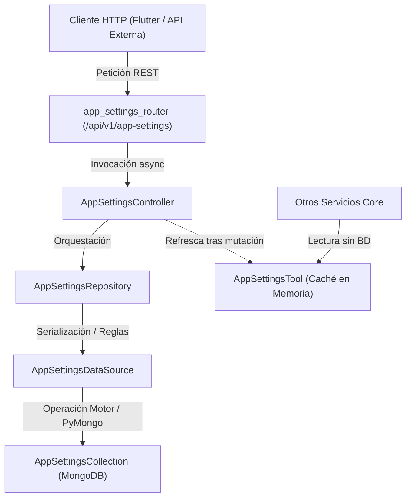

# Documentación del Módulo: Configuraciones Globales (`app_settings`)

El módulo **Configuraciones Globales (`app_settings`)** centraliza y administra los parámetros operativos, comerciales y logísticos que rigen el comportamiento del sistema `kardex-server`.

---

## 1. Arquitectura y Flujo de Datos (Onion Architecture)

El módulo sigue la arquitectura desacoplada estricta del backend:

---

## 2. Componentes del Módulo

### 2.1. Colección MongoDB (`AppSettings`)
- **Archivo:** `packages/kardex-business/src/kardex/services/mongo_collections/v1/app_settings_collection.py`
- **Nombre de colección:** `"AppSettings"`
- **Operaciones:**
  - `create_app_setting(dict)`: Inserción directa.
  - `create_app_setting_if_absent(dict)`: Inserción atómica con `find_one_and_update(..., upsert=True)`.
  - `fetch_all_app_settings()`: Obtiene todos los documentos.
  - `fetch_app_setting_by_id(id)`: Búsqueda por `id`.
  - `update_app_setting_by_id(id, dict)`: Actualización con retorno del documento posterior a la modificación (`ReturnDocument.AFTER`).
  - `delete_app_setting_by_id(id)`: Eliminación por `id`.

---

### 2.2. Modelos Pydantic v2
- **Archivo:** `packages/kardex-business/src/kardex/repos/v1/app_settings/models/app_setting_model.py`

| Campo | Tipo | Valor por Defecto | Descripción |
| :--- | :--- | :--- | :--- |
| `id` | `str` | `"Default"` | Identificador único del registro de configuración. |
| `useDefaultProfitMargin` | `bool` | `False` | Indica si el sistema debe aplicar/sugerir automáticamente el margen por defecto. |
| `defaultProfitMargin` | `float` | `20.0` | Porcentaje de margen de ganancia comercial por defecto (ej. 20%). |
| `useExpirationDates` | `bool` | `True` | Activa o desactiva el seguimiento de lotes y fechas de vencimiento. |
| `useOrders` | `bool` | `True` | Habilita el módulo comercial de órdenes de compra/venta. |
| `useQuotations` | `bool` | `True` | Habilita el módulo de cotizaciones y presupuestos/proformas. |
| `allowNegativeStock` | `bool` | `False` | Permite o bloquea facturación de productos sin existencias en sucursal. |
| `alertMinStock` | `bool` | `True` | Activa alertas de inventario mínimo o crítico. |
| `defaultPaymentTermDays` | `int` | `30` | Plazo predeterminado en días para facturas a crédito. |
| `useHoldSales` | `bool` | `True` | Permite pausar y reanudar ventas pendientes (ventas en espera). |
| `useQuickProductSearch` | `bool` | `False` | Abre el buscador rápido con botones de agregar y quitar cantidad al agregar productos en móvil (facturas, órdenes y cotizaciones). |
| `createdAt` | `int` | Unix ms | Fecha y hora de creación en milisegundos. |
| `updatedAt` | `int \| None` | `None` | Fecha y hora de última actualización en milisegundos. |

- **Modelos disponibles:**
  - `BaseAppSetting`: Atributos comunes.
  - `CreateAppSetting`: Modelo de creación con `id: "Default"`.
  - `UpdateAppSetting`: Modelo de actualización parcial (`PATCH`) con todos los campos opcionales (`None`).
  - `AppSettingInDb`: Entidad persistida en MongoDB con sellos de tiempo.

---

### 2.3. Repositorio y Fuente de Datos
- **Fuente de Datos:** `packages/kardex-business/src/kardex/repos/v1/app_settings/data/app_settings_datasource.py`
  - Puente directo con `AppSettingsCollection.get_instance()`.
- **Repositorio:** `packages/kardex-business/src/kardex/repos/v1/app_settings/app_settings_repository.py`
  - Implementa el patrón Singleton `get_instance()`.
  - Provee `get_current_app_settings()`: Obtiene el registro `"Default"` o lo crea automáticamente al vuelo si la base de datos está vacía.
  - `update_app_setting_by_id()`: Aplica `model_dump(exclude_unset=True)` e inyecta la marca de tiempo `updatedAt = TimeTools.get_now_in_milliseconds()`.

---

### 2.4. Herramienta Singleton en Memoria (`AppSettingsTool`)
- **Archivo:** `packages/kardex-business/src/kardex/tools/app_settings_tool.py`
- **Propósito:** Mantener en la memoria del proceso del servidor una copia en caliente de `AppSettingInDb` para permitir lecturas sin costo de acceso a MongoDB.
- **Métodos:**
  - `get_current_app_settings() -> AppSettingInDb`: Retorna la configuración en caché (la consulta a la base de datos sólo si está vacía).
  - `refresh_current_app_settings() -> None`: Recarga forzosamente la configuración activa desde la base de datos (se ejecuta automáticamente tras cualquier `PATCH` o `DELETE`).

---

### 2.5. Inicialización en el Arranque (`Lifespan`)
- **Función:** `create_default_app_settings()` en `packages/kardex-business/src/kardex/core/default_values/create_default_app_settings.py`.
- **Ejecución:** En `app/core/services_initializer.py`, durante el arranque de FastAPI (`lifespan` en `app_lifespan.py`).
- Si la colección `AppSettings` no contiene el registro `"Default"`, se inicializa atómicamente con los valores por defecto del sistema.

---

## 3. Endpoints REST (`/api/v1/app-settings`)

Controlador: `app/api/v1/app_settings/app_settings_controller.py`  
Router: `app/api/v1/app_settings/app_settings_router.py`

| Método | Endpoint | Respuesta | Descripción |
| :--- | :--- | :--- | :--- |
| `GET` | `/api/v1/app-settings/current` | `AppSettingInDb` | Retorna la configuración activa actual desde el caché en memoria de `AppSettingsTool`. |
| `GET` | `/api/v1/app-settings` | `ListResponse[AppSettingInDb]` | Lista todas las configuraciones registradas. |
| `GET` | `/api/v1/app-settings/{id}` | `AppSettingInDb` | Consulta la configuración por identificador (ej. `"Default"`). Retorna 404 si no existe. |
| `POST` | `/api/v1/app-settings` | `AppSettingInDb` | Crea un nuevo registro de configuración a partir de `CreateAppSetting`. |
| `PATCH` | `/api/v1/app-settings/{id}` | `AppSettingInDb` | Actualiza parcialmente campos mediante `UpdateAppSetting`, sella `updatedAt` y refresca el caché de `AppSettingsTool`. |
| `DELETE` | `/api/v1/app-settings/{id}` | `AppSettingInDb` | Elimina la configuración por `id` y refresca el caché. |
