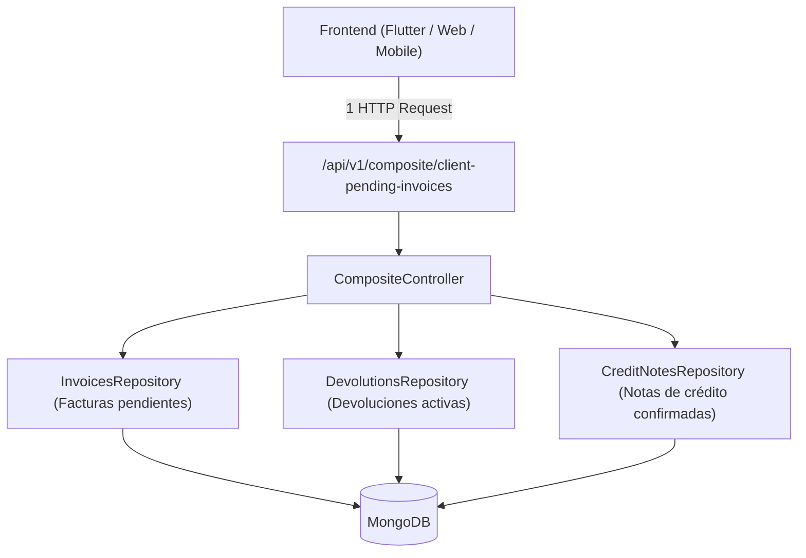

# Módulo de Servicios Compuestos / Composite Router (`app/api/v1/composite`)

El módulo **Composite** implementa el patrón de arquitectura **API Composition / Aggregator (BFF - Backend for Frontend)**. Su propósito es consolidar múltiples fuentes de datos y modelos del sistema en respuestas compuestas y precalculadas en una única petición HTTP, optimizando la latencia de red y evitando múltiples viajes de ida y vuelta (*roundtrips*) desde el cliente Flutter.

---

## 1. Justificación Arquitectónica

Antes de la existencia de este router, pantallas con flujos multidominio (como **Facturas por cobrar al cliente / Cobranzas**) disparaban 3 consultas HTTP simultáneas:
1. `GET /api/v1/invoices/pending/{client_id}`
2. `GET /api/v1/devolutions/all/active?client_id=...&branch_id=...`
3. `GET /api/v1/credit-notes/?client_id=...&status=confirmed`

Con el patrón **Composite**, el servidor resuelve las 3 consultas internamente contra MongoDB en paralelo (`asyncio.gather`) con latencia casi nula, computa el balance canónico del cliente y entrega una única respuesta estructurada.



---

## 2. Endpoints Disponibles

### `GET /api/v1/composite/client-pending-invoices`

Obtiene todas las facturas pendientes de cobro, devoluciones activas a favor y notas de crédito confirmadas disponibles de un cliente para una sucursal, junto con el resumen consolidado de totales.

- **Seguridad:** Requiere autenticación Bearer JWT (`auth_middleware`).
- **Query Parameters:**
  - `clientId` (o `client_id`, `str`, requerido): Identificador del cliente.
  - `branchId` (o `branch_id`, `str`, requerido): Identificador de la sucursal actual.

#### Respuesta JSON (`ClientPendingInvoicesCompositeResponse`):
```json
{
  "invoices": [
    {
      "id": "inv_123",
      "docNumber": "000452",
      "total": 50000,
      "amountPaid": 10000,
      "totalRemaining": 40000,
      ...
    }
  ],
  "devolutions": [
    {
      "id": "dev_789",
      "docNumber": "DEV-0012",
      "total": 5000,
      "status": "confirmed",
      ...
    }
  ],
  "creditNotes": [
    {
      "id": "cn_456",
      "docNumber": "NC-0008",
      "type": "amount",
      "amount": 10000,
      "status": "confirmed",
      ...
    }
  ],
  "summary": {
    "totalInvoices": 40000,
    "totalDevolutions": 5000,
    "totalCreditNotes": 10000,
    "netTotalPayable": 25000
  }
}
```

---

## 3. Modelos Pydantic (`composite_models.py`)

- **`PendingCheckoutSummary`:**
  - `totalInvoices` (`int` en centavos): Sumatoria de `totalRemaining` de todas las facturas pendientes.
  - `totalDevolutions` (`int` en centavos): Sumatoria de devoluciones activas aplicables.
  - `totalCreditNotes` (`int` en centavos): Sumatoria de notas de crédito confirmadas disponibles.
  - `netTotalPayable` (`int` en centavos): Balance neto a pagar `max(0, totalInvoices - totalDevolutions - totalCreditNotes)`.
- **`ClientPendingInvoicesCompositeResponse`:**
  - `invoices: list[InvoiceInDb]`
  - `devolutions: list[DevolutionInDb]`
  - `creditNotes: list[CreditNoteInDb]`
  - `summary: PendingCheckoutSummary`

---

## 4. Guía para Futuros Desarrolladores / Agentes

Al incorporar nuevas pantallas o flujos en el frontend que requieran combinar datos de 2 o más entidades en un solo tiempo de carga (ej. estado de cuenta integral, cierre combinado de turno, o liquidaciones de caja):
1. **Evitar** disparar múltiples peticiones HTTP encadenadas en el cliente.
2. **Extender** `app/api/v1/composite/` agregando el endpoint agregado correspondiente.
3. Mantener siempre la convención de tipos (`camelCase` en atributos, montos enteros en centavos y timestamps Unix en milisegundos).
