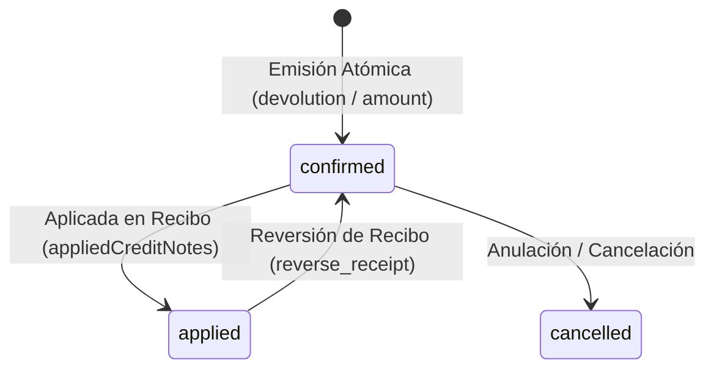

# Documentación del Módulo: Notas de Crédito (`credit_notes`)

El módulo **Notas de Crédito (`CreditNote`)** representa la evolución y sustitución progresiva de las devoluciones tradicionales en `kardex-server`. Provee un mecanismo formal, trazable y contable para gestionar retornos de productos o concesión de saldos a favor para clientes, integrándose de forma atómica con el inventario físico (Kárdex), cuentas por cobrar y emisión de recibos de pago.

---

## 1. Arquitectura del Módulo (Onion Pattern)

Siguiendo el estándar de arquitectura limpia del servidor:

```text
kardex-server/
├── app/
│   └── api/v1/credit_notes/
│       ├── credit_notes_router.py       # Endpoints REST (FastAPI con auth_middleware)
│       └── credit_notes_controller.py   # Controlador y empaquetado ListResponse
└── packages/kardex-business/src/kardex/
    ├── repos/v1/credit_notes/
    │   ├── models/credit_note_model.py  # Modelos Pydantic v2 (camelCase)
    │   ├── data/credit_notes_datasource.py # DataSource hacia MongoDB
    │   └── credit_notes_repository.py   # Repositorio de negocio
    ├── services/mongo_collections/v1/
    │   └── credit_notes_collection.py   # Colección MongoDB (CreditNotes)
    ├── repos/v1/common/filter_params/
    │   └── credit_note_filter_params.py # Parámetros de consulta y paginación
    └── core/credit_note_register/
        ├── credit_note_register.py      # Validaciones previas de negocio
        └── process_credit_note.py       # Transacción atómica en MongoDB
```

---

## 2. Modalidades Operativas (`CreditNoteType`)

La nota de crédito soporta dos tipos de operación:

1. **Por Devolución (`CreditNoteType.devolution`)**:
   - Vinculada obligatoriamente a una factura original mediante `originalInvoiceId` y `originalInvoiceDocNumber`.
   - Especifica la lista de productos retornados (`returnedItems: list[SaleItem]`).
   - **Efecto en Inventario:** Incrementa automáticamente el stock disponible en la sucursal emisora y genera un movimiento formal en el Kárdex (`ProductTransaction` con `subtype="credit_note"` y `type="entry"`).
   - **Estado Inicial:** Nace en estado `confirmed`. Si la factura de origen fue a crédito, el monto queda disponible como saldo a favor para aplicarse en el siguiente pago/recibo del cliente.

2. **Por Monto (`CreditNoteType.amount`)**:
   - Asociada directamente a un cliente registrado (`clientId` y `clientInfo`).
   - Requiere un motivo detallado obligatorio (`description`).
   - No afecta inventario físico ni genera movimientos de Kárdex.
   - Nace en estado `confirmed` para amortizar deudas del cliente en el módulo de cobranza.

---

## 3. Estados de la Nota de Crédito (`CreditNoteStatus`)



- **`open`**: Estado inicial para borradores (si aplica).
- **`confirmed`**: Nota emitida formalmente, con stock reingresado (si es devolución). Disponible para ser aplicada a cuentas por cobrar.
- **`applied`**: Aplicada en un recibo oficial de pago (`appliedReceiptId`), reduciendo la deuda del cliente con `ClientTransaction` (`subtype="credit_note"`).
- **`cancelled`**: Anulada, revirtiendo sus efectos contables y de inventario.

---

## 4. Modelos de Dominio (`credit_note_model.py`)

Todos los campos utilizan nomenclatura **`camelCase`** para interoperabilidad con MongoDB y Flutter:

```python
class CreditNoteType(str, Enum):
    devolution = "devolution"
    amount = "amount"

class CreditNoteStatus(str, Enum):
    open = "open"
    confirmed = "confirmed"
    cancelled = "cancelled"
    applied = "applied"

class BaseCreditNote(BaseModel):
    branchId: str
    clientId: str
    clientInfo: ClientInfo
    type: CreditNoteType
    docNumber: str = ""
    originalInvoiceId: str = ""
    originalInvoiceDocNumber: str = ""
    returnedItems: list[SaleItem] = []
    amount: int                                  # Monto monetario en centavos
    description: str = ""
    status: CreditNoteStatus = CreditNoteStatus.confirmed
    createdBy: UserInfo
    appliedReceiptId: str | None = None
    appliedReceiptDocNumber: str | None = None
    appliedAt: int | None = None

class CreateCreditNote(BaseCreditNote):
    pass

class UpdateCreditNote(BaseModel):
    status: CreditNoteStatus | None = None
    appliedReceiptId: str | None = None
    appliedReceiptDocNumber: str | None = None
    appliedAt: int | None = None

class CreditNoteInDb(BaseCreditNote):
    id: str                                      # UUID v4
    createdAt: int                               # Timestamp en milisegundos
    updatedAt: int | None = None
```

---

## 5. Proceso Atómico Core (`process_credit_note.py`)

La emisión de notas de crédito se ejecuta dentro de una sesión transaccional de MongoDB (`client.start_session()`):

1. **Generación de Folio Consecutivo:** Obtiene el siguiente folio único por sucursal mediante `CounterManager.next_credit_note_number()`.
2. **Reingreso de Inventario (Devolución):**
   - Para cada producto en `returnedItems`, incrementa su stock físico (`stock += qty`) en la colección `Products`.
   - Inserta un registro en `ProductTransactions` con `subtype="credit_note"`, tipo `entry`, referenciando el folio de la nota.
3. **Persistencia de la Nota:** Inserta el documento en `CreditNotes` en estado `confirmed`.

---

## 6. Integración con el Módulo de Recibos (`process_receipt.py`)

Cuando un cliente con compras a crédito realiza un pago o abono:

1. El payload de `CreateReceipt` incluye `appliedCreditNotes: list[AppliedCreditNote]`.
2. `process_receipt.py` valida la existencia y estado `confirmed` de cada nota de crédito.
3. Suma el monto de las notas de crédito al total de fondos aplicados a las facturas pendientes (`total_funds = cash + devolutions + credit_notes`).
4. Amortiza las facturas pendientes reduciendo `amountPaid` y `totalRemaining`.
5. Por cada nota de crédito aplicada:
   - Modifica el estado de la nota a `applied`, registrando `appliedReceiptId`, `appliedReceiptDocNumber` y `appliedAt`.
   - Emite una transacción de cliente (`ClientTransactionInDb`) con `subtype="credit_note"`, debitando el saldo pendiente del cliente.
6. **Reversión (`reverse_receipt.py`):** Si un recibo es revertido/anulado, las notas de crédito aplicadas retornan a su estado `confirmed`, y la deuda del cliente se restablece atómicamente.

---

## 7. Permisos y Seguridad (`role_manager.py`)

Se agregaron los siguientes permisos dentro del módulo comercial:

- `CREATE_CREDIT_NOTE`: Autoriza la emisión de notas de crédito por devolución o monto.
- `CREDIT_NOTE_HISTORY`: Autoriza la consulta del historial maestro y auditoría de notas de crédito.

---

## 8. Catálogo de Endpoints REST (`/api/v1/credit-notes`)

Todos los endpoints requieren autenticación mediante JWT (`auth_middleware`):

| Método | Endpoint | Descripción | Respuesta |
| :--- | :--- | :--- | :--- |
| `POST` | `/api/v1/credit-notes` | Emite y procesa una nueva nota de crédito | `CreditNoteInDb` |
| `GET` | `/api/v1/credit-notes` | Lista paginada con filtros (`status`, `type`, fechas, cliente) | `ListResponse[CreditNoteInDb]` |
| `GET` | `/api/v1/credit-notes/all/active` | Consulta notas activas (`open` y `confirmed`) | `ListResponse[CreditNoteInDb]` |
| `GET` | `/api/v1/credit-notes/client/{client_id}` | Notas de crédito asociadas a un cliente específico | `ListResponse[CreditNoteInDb]` |
| `GET` | `/api/v1/credit-notes/invoice/{invoice_id}` | Notas vinculadas a una factura en particular | `ListResponse[CreditNoteInDb]` |
| `GET` | `/api/v1/credit-notes/doc/{doc_number}` | Búsqueda por folio consecutivo | `CreditNoteInDb` |
| `GET` | `/api/v1/credit-notes/{id}` | Búsqueda por identificador UUID | `CreditNoteInDb` |
