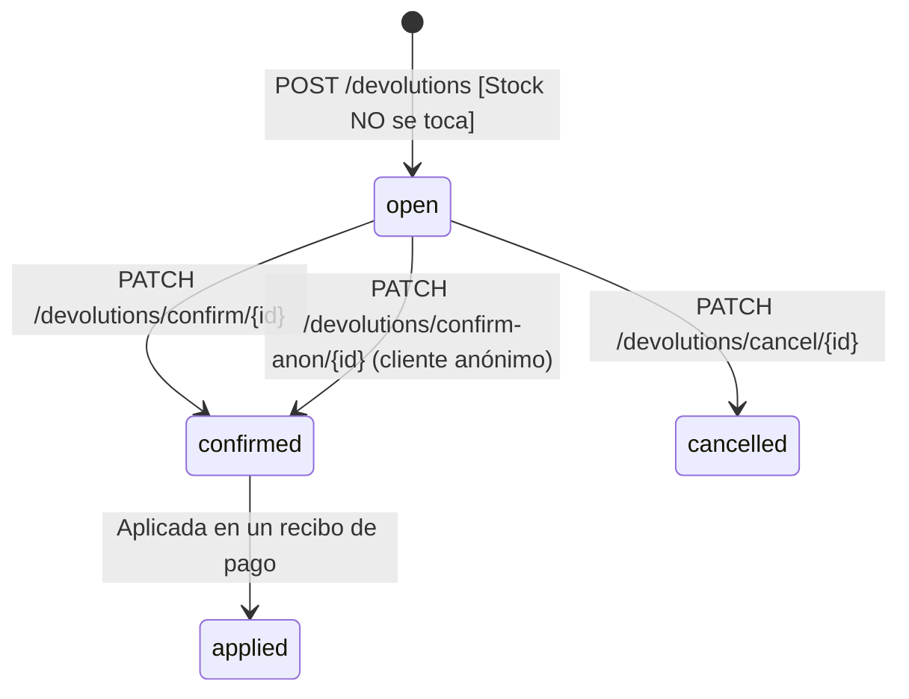

# Documentación del Módulo: Devoluciones (`devolutions`)

El módulo **Devoluciones (`Devolution`)** registra el retorno de productos de una factura. Convive con las [notas de crédito](./credit_notes.md): las devoluciones se usan para facturas de contado y las notas de crédito por devolución para facturas a crédito.

---

## 1. Arquitectura del Módulo (Onion Pattern)

```text
kardex-server/
├── app/api/v1/devolutions/
│   ├── devolutions_router.py            # Endpoints REST (JWT)
│   └── devolutions_controller.py        # Controlador
└── packages/kardex-business/src/kardex/
    ├── repos/v1/devolutions/
    │   ├── models/devolution_model.py   # Modelos Pydantic (camelCase)
    │   ├── data/devolutions_datasource.py
    │   └── devolutions_repository.py
    ├── services/mongo_collections/v1/
    │   └── devolutions_collection.py    # Colección Devolutions
    ├── core/devolution_register/
    │   ├── devolution_register.py       # Validaciones y confirmación
    │   └── process_devolution.py        # Transacciones atómicas (registrado y anónimo)
    └── core/policies/devolutions/
        └── devolution_policy.py         # Reglas puras de cabecera y estados
```

---

## 2. Estados y Transiciones (`DevolutionStatus`)



- **`open`**: estado inicial; la devolución aún no afecta inventario ni saldos.
- **`confirmed`**: reingresa el stock físico y registra el movimiento de Kárdex.
- **`cancelled`**: anulada antes de confirmarse.
- **`applied`**: usada como fondo en un recibo de pago (`appliedDevolutions`).

Confirmar una devolución de cliente registrado exige el endpoint normal; el cliente genérico de venta (`SALE_CLIENT_ID`) debe usar `confirm-anon`. Al confirmar solo se aceptan devoluciones en estado `open`.

---

## 3. Capa de Políticas (Policy Object)

`DevolutionPolicy` vive en `core/policies/devolutions/devolution_policy.py` y es pura: sin FastAPI, Mongo, `AppSettingsTool`, `session` ni IO. `DevolutionRegister` resuelve la sucursal, el cliente, los productos y la factura, consulta la policy y traduce cada rechazo con `_ensure_allowed` a `InvalidOperation(reason)`.

| Método de `DevolutionPolicy` | Regla evaluada | Motivo de rechazo |
| :--- | :--- | :--- |
| `items_decision(returned_items)` | La devolución incluye al menos un producto. | `"La devolución debe incluir al menos un producto."` |
| `invoice_decision(invoice)` | La factura no está anulada, no tiene descuento global y, si es a crédito, no tiene abonos ni está pagada. | `"Cannot create a devolution for a cancelled invoice."`, `"No se permiten devoluciones por producto en facturas con descuento global."`, `"No se permiten devoluciones sobre facturas a crédito con abonos o pagadas."` |
| `confirmation_client_decision(devolution, *, anonymous, sale_client_id)` | El endpoint de confirmación corresponde al tipo de cliente. | `"Use the anonymous devolution endpoint for this client."`, `"Invalid client ID for anonymous devolution."` |
| `status_decision(devolution)` | La devolución sigue en estado `open`. | `"Devolution is not open."` |

La validación de cantidades devueltas y el prorrateo contra las líneas de la factura permanecen en `DevolutionRegister._validate_returned_quantities` y en los helpers de `process_credit_note.py`.

---

## 4. Endpoints REST (`/api/v1/devolutions`)

| Método | Endpoint | Descripción |
| :--- | :--- | :--- |
| `POST` | `/api/v1/devolutions` | Crea la devolución en estado `open`. |
| `GET` | `/api/v1/devolutions` | Lista devoluciones con filtros y paginación. |
| `GET` | `/api/v1/devolutions/all/active` | Lista devoluciones activas. |
| `GET` | `/api/v1/devolutions/history` | Historial de devoluciones por cliente. |
| `GET` | `/api/v1/devolutions/doc/{doc_number}` | Busca una devolución por folio. |
| `GET` | `/api/v1/devolutions/{id}` | Busca una devolución por identificador. |
| `PATCH` | `/api/v1/devolutions/confirm/{id}` | Confirma una devolución de cliente registrado. |
| `PATCH` | `/api/v1/devolutions/confirm-anon/{id}` | Confirma una devolución del cliente genérico. |
| `PATCH` | `/api/v1/devolutions/cancel/{id}` | Cancela una devolución abierta. |
| `DELETE` | `/api/v1/devolutions/{id}` | Elimina una devolución. |
