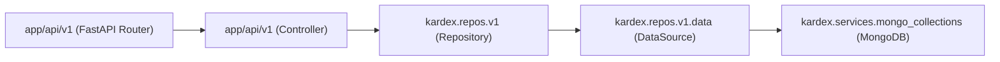

# Índice General del Proyecto y Guía de Arquitectura (`kardex-server`)

Bienvenido a la documentación arquitectónica y técnica de **Kardex Server**.

> **Documento heredado.** Se conserva por su valor histórico y por la visión general de datos. El punto de entrada actual es [`INDEX.md`](./INDEX.md).
>
> **Navegación rápida para agentes**
>
> - 🧭 [`INDEX.md`](./INDEX.md) — hub: estructura, dónde está cada cosa y catálogo de enlaces.
> - 🏗️ [`architecture.md`](./architecture.md) — capas, flujo y multi-tenant.
> - 🧱 [`conventions.md`](./conventions.md) — convenciones de código y datos.
> - 🔐 [`security.md`](./security.md) — guards y routers protegidos.
> - ⚙️ [`operations.md`](./operations.md) — ejecución, entorno y verificación.
> - 🗂️ [`modules/INDEX.md`](./modules/INDEX.md) — catálogo de los **48 módulos** del API con router, repo, colección y proceso.
> - 📚 Documentos de módulo: [`app_settings.md`](./modules/app_settings.md), [`unit_scales.md`](./modules/unit_scales.md), [`credit_notes.md`](./modules/credit_notes.md), [`composite.md`](./modules/composite.md).

---

## 1. Visión General del Proyecto

`kardex-server` es el backend empresarial de **Kardex App**, construido con **Python 3.13**, **FastAPI** y respaldado por **MongoDB** (motor asíncrono Motor / PyMongo). Provee la lógica de negocio, trazabilidad transaccional de kárdex, facturación, cuentas por cobrar y parámetros globales para clientes móviles, web y de escritorio.

---

## 2. Patrón Arquitectónico (Onion Architecture)

El servidor sigue estrictamente el patrón de **Arquitectura de Cebolla (Onion / Clean Architecture)**:

### Reglas por Capa:
1. **Paquete de Dominio (`packages/kardex-business/src/kardex/`):**
   - No tiene ninguna dependencia de FastAPI ni capas de transporte web.
   - Contiene los modelos Pydantic v2, data sources, repositorios, colecciones de MongoDB y herramientas en memoria (`tools`).
   - Todos los modelos Pydantic utilizan nomenclatura **`camelCase`** en sus atributos para interoperabilidad limpia con MongoDB y Flutter.
2. **Capa Web Local (`app/`):**
   - Delgada capa de transporte HTTP con FastAPI.
   - Define los controladores y routers organizados por entidad y versión (`app/api/v1/`).
   - Centraliza el ciclo de vida de la aplicación (`app_lifespan.py`), inicializaciones (`services_initializer.py`) y manejadores globales de excepciones (`regis_exception_handlers.py`).

---

## 3. Convenciones Técnicas de Datos

- **Fechas:** Siempre se representan como marcas de tiempo Unix en milisegundos (`int`).
- **Moneda / Dinero:** Montos numéricos monetarios siempre se representan en centavos enteros (`int`).
- **Nombres de colecciones:** PascalCase en plural o singular descriptivo (ej. `AppSettings`, `Products`, `Invoices`, `UnitScales`).
- **Identificadores:** Strings alfanuméricos o UUIDs generados con `UuidTool`.

---

## 4. Índice de Documentación Modular

El mapa completo de routers, repositorios y colecciones está en **[`modules/INDEX.md`](./modules/INDEX.md)** (48 módulos del API). A continuación, los documentos con especificación técnica profunda:

- ⚙️ **[Configuraciones Globales (modules/app_settings.md)](./modules/app_settings.md)** - Gestión de parámetros de sistema: márgenes de ganancia, banderas de órdenes, cotizaciones, vencimientos, inventario negativo y caché en memoria `AppSettingsTool`.
- ⚖️ **[Escalas de Unidades (modules/unit_scales.md)](./modules/unit_scales.md)** - Plantillas de conversión estandarizadas (Peso, Volumen, Longitud, Tiempo y personalizadas) para productos y parámetros en MongoDB.
- 📋 **[Notas de Crédito (modules/credit_notes.md)](./modules/credit_notes.md)** - Gestión integral de notas de crédito por devolución (con reingreso al Kárdex) y por monto, emisión atómica y amortización en recibos de pago.
- 🧩 **[Servicios Compuestos / Composite API (modules/composite.md)](./modules/composite.md)** - Endpoints agregados (BFF) para consolidar facturación, devoluciones y notas de crédito en 1 sola petición HTTP atómica.
