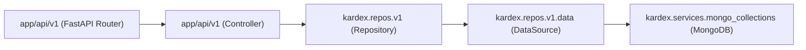

# Índice General del Proyecto y Guía de Arquitectura (`kardex-server`)

Bienvenido a la documentación arquitectónica y técnica de **Kardex Server**.

---

## 1. Visión General del Proyecto

`kardex-server` es el backend empresarial de **Kardex App**, construido con **Python 3.13**, **FastAPI** y respaldado por **MongoDB** (motor asíncrono Motor / PyMongo). Provee la lógica de negocio, trazabilidad transaccional de kárdex, facturación, cuentas por cobrar y parámetros globales para clientes móviles, web y de escritorio.

---

## 2. Patrón Arquitectónico (Onion Architecture)

El servidor sigue estrictamente el patrón de **Arquitectura de Cebolla (Onion / Clean Architecture)**:

### Reglas por Capa:
1. **Paquete de Dominio (`packages/kardex-business/src/kardex/`):**
   - No tiene ninguna dependencia de FastAPI ni capas de transporte web.
   - Contiene los modelos Pydantic v2, data sources, repositorios, colecciones de MongoDB y herramientas en memoria (`tools`).
   - Todos los modelos Pydantic utilizan nomenclatura **`camelCase`** en sus atributos para interoperabilidad limpia con MongoDB y Flutter.
2. **Capa Web Local (`app/`):**
   - Delgada capa de transporte HTTP con FastAPI.
   - Define los controladores y routers organizados por entidad y versión (`app/api/v1/`).
   - Centraliza el ciclo de vida de la aplicación (`app_lifespan.py`), inicializaciones (`services_initializer.py`) y manejadores globales de excepciones (`regis_exception_handlers.py`).

---

## 3. Convenciones Técnicas de Datos

- **Fechas:** Siempre se representan como marcas de tiempo Unix en milisegundos (`int`).
- **Moneda / Dinero:** Montos numéricos monetarios siempre se representan en centavos enteros (`int`).
- **Nombres de colecciones:** PascalCase en plural o singular descriptivo (ej. `AppSettings`, `Products`, `Invoices`).
- **Identificadores:** Strings alfanuméricos o UUIDs generados con `UuidTool`.

---

## 4. Índice de Documentación Modular

Para conocer a fondo la especificación técnica de cada módulo del backend:

- ⚙️ **[Configuraciones Globales (modules/app_settings.md)](./modules/app_settings.md)** - Gestión de parámetros de sistema: márgenes de ganancia, banderas de órdenes, cotizaciones, vencimientos, inventario negativo y caché en memoria `AppSettingsTool`.
