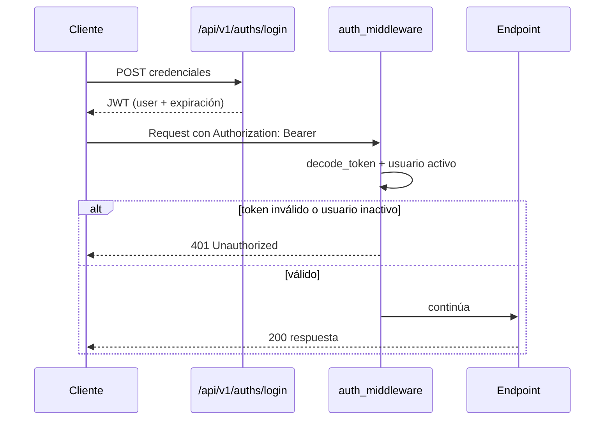

# Seguridad y Multi-tenant (`kardex-server`)

Cómo se autentica una petición, cómo se propaga el tenant/sucursal y qué routers deben revisarse antes de asumir que están protegidos.

---

## 1. Guards disponibles

Ubicación: `app/app_middleware/depends/`.

| Guard | Archivo | Qué valida | Uso |
| :--- | :--- | :--- | :--- |
| `multi_tenant_middleware` | `multi_tenant.py` | Header de tenant obligatorio, patrón y reservados; publica `KardexContext`. | Dependencia global de `router_v1`. |
| `auth_middleware` | `auth_middleware.py` | `Authorization: Bearer <JWT>`, token válido, claim `tenant` == header y usuario no inactivo. | Estándar de la mayoría de routers. |
| `api_key_middleware` | `api_key_middleware.py` | API Key para integraciones externas. | `/bi` (Power BI). |
| `validate_super_token` | dependencia de `core_settings` | Token de superusuario/plataforma (Ed25519). | `/core-settings`. |

Se montan a nivel de router:

```python
router = APIRouter(
    tags=["mi_moduloV1"],
    dependencies=[Depends(auth_middleware)],
)
```

---

## 2. Flujo de autenticación



- El login (`POST /auths/login`) debe ser público por diseño.
- `POST /auths/refresh-token` permite renovar sin volver a credenciales.
- `GET /auths/servin-status` y `GET /auths/user-status/{user_id}` son de estado, no de negocio.

---

## 3. Multi-tenant y sucursal

El servidor es **database-per-tenant**. El contexto viaja en headers y se guarda en un `ContextVar`:

```python
@dataclass
class KardexContext:
    businessNickname: str = ""
    branchId: str = ""

kardexCtx = contextvars.ContextVar("kardexCtx", default=KardexContext())
```

| Header | Significado | Ejemplo |
| :--- | :--- | :--- |
| `X-Servin` (o `x-tenant-nickname`) | **Tenant**: nombre de la base de datos | `tienda-a` |
| `X-Branch` (o `x-branch-id`) | Sucursal activa | `ORIGIN_BRANCH` |

Reglas:

1. **Sin header de tenant, toda ruta `/api/v1` responde 400.** No hay fallback a `DB_NAME`.
2. El nickname se normaliza con `.strip().lower()`; patrón `^[a-z0-9][a-z0-9_-]{2,48}$` y reservados `admin/local/config/kardexcontrol`.
3. No hardcodees `branchId` en repos ni procesos.
4. Los procesos de `kardex/core/` leen `kardexCtx` para resolver la base y la sucursal.
5. El JWT lleva el claim `tenant`; `auth_middleware` y `refresh-token` lo comparan con el header y responden 403 si no coincide.
6. Las tareas de fondo usan `run_with_tenant_context(nickname, fn, ...)`.
7. Clientes externos con `X-API-KEY` también deben enviar `X-Servin`.

---

## 4. Guards por router

| Módulo | Guard |
| :--- | :--- |
| `auths` | Público por diseño (`login`, `refresh-token`, `servin-status`, `user-status`, `change-password`). No añadir `auth_middleware`. |
| `bi` | `api_key_middleware` (Power BI). El cliente debe enviar también `X-Servin`. |
| `core_settings` | `validate_super_token` (Ed25519). `POST`/`PATCH`/`DELETE` exigen además el content token con el nickname. |
| Resto de módulos de negocio | `auth_middleware` a nivel de `APIRouter`. |

Los routers de negocio que antes no tenían guard (`app_settings`, `products`, `product_categories`, `product_prices`, `product_accounts`, `product_stats`, `product_transactions`, `expenses`, `expense_categories`, `exports`, `reports`, `user_roles`, `integrations`, `daily_summaries`) ya lo declaran. Sin token responden **401**; sin header de tenant, **400**.

> Al agregar un módulo nuevo, declara `dependencies=[Depends(auth_middleware)]` en su `APIRouter`.

---

## 5. Cómo proteger un módulo nuevo

```python
from fastapi import APIRouter, Depends
from app_middleware.depends.auth_middleware import auth_middleware

mi_router = APIRouter(
    tags=["mi_moduloV1"],
    dependencies=[Depends(auth_middleware)],
)
```

Checklist:

- [ ] `dependencies=[Depends(auth_middleware)]` en el `APIRouter`.
- [ ] Endpoints públicos (login, health) separados y justificados.
- [ ] El controller/repo no confía en datos de tenant enviados en el body.
- [ ] Los endpoints por sucursal usan `X-Servin` o parámetro explícito.
- [ ] Los endpoints administrativos globales usan `validate_super_token`.
- [ ] Las integraciones externas usan `api_key_middleware`, no JWT de usuario.

---

## 6. Notas específicas

- **BI (`/bi`):** se autentica con API Key porque lo consume Power BI, no un usuario de la app.
- **Core settings (`/core-settings`):** exige super-token Ed25519. `POST` valida `body.nickname` contra el claim y aprovisiona el tenant; `PATCH` exige `path == claim.nickname`; `DELETE` valida el dueño del registro.
- **CORS:** `app/main.py` permite `allow_origins=["*"]`. Si el despliegue lo requiere, restringir antes de producción.
- **OpenAPI:** se oculta con `MODE=PROD` (`openapi_url=None`).
- **Usuarios inactivos:** `auth_middleware` consulta `UsersTool` y rechaza usuarios desactivados.
