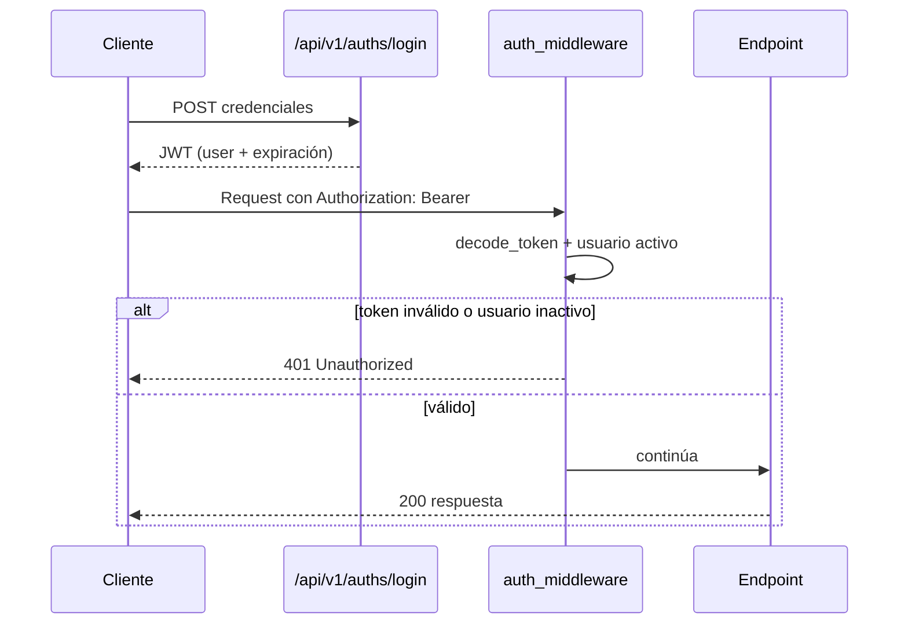

# Seguridad y Multi-tenant (`kardex-server`)

Cómo se autentica una petición, cómo se propaga el tenant/sucursal y qué routers deben revisarse antes de asumir que están protegidos.

---

## 1. Guards disponibles

Ubicación: `app/app_middleware/depends/`.

| Guard | Archivo | Qué valida | Uso |
| :--- | :--- | :--- | :--- |
| `auth_middleware` | `auth_middleware.py` | `Authorization: Bearer <JWT>`, token válido y usuario no inactivo. | Estándar de la mayoría de routers. |
| `api_key_middleware` | `api_key_middleware.py` | API Key para integraciones externas. | `/bi` (Power BI). |
| `validate_super_token` | `multi-tenant.py` y dependencia de core | Token de superusuario/plataforma. | `/core-settings`. |
| `multi_tenant_middleware` | `multi-tenant.py` | Publica el `KardexContext` del request. | Contexto de tenant/sucursal. |

Se montan a nivel de router:

```python
router = APIRouter(
    tags=["mi_moduloV1"],
    dependencies=[Depends(auth_middleware)],
)
```

---

## 2. Flujo de autenticación



- El login (`POST /auths/login`) debe ser público por diseño.
- `POST /auths/refresh-token` permite renovar sin volver a credenciales.
- `GET /auths/servin-status` y `GET /auths/user-status/{user_id}` son de estado, no de negocio.

---

## 3. Multi-tenant y sucursal

El contexto viaja en headers y se guarda en un `ContextVar`:

```python
@dataclass
class KardexContext:
    businessNickname: str = ""
    branchId: str = ""

kardexCtx = contextvars.ContextVar("kardexCtx", default=KardexContext())
```

| Header | Significado | Ejemplo |
| :--- | :--- | :--- |
| `X-Servin` | Sucursal activa | `branch-001` |
| `x-tenant-nickname` | Alias del negocio/tenant | `mi-negocio` |

Reglas:

1. No hardcodees `branchId` en repos ni procesos.
2. Respeta el header o el path/query param del endpoint.
3. Los procesos de `kardex/core/` leen `kardexCtx` para resolver la sucursal.
4. Si agregas un endpoint que opera por sucursal, declara el parámetro explícitamente.

---

## 4. Routers sin guard a nivel de router

Al día de hoy, estos módulos **no** declaran `dependencies=[Depends(...)]` en su `APIRouter`:

| Módulo | Observación |
| :--- | :--- |
| `auths` | Esperado: el login debe ser público. Revisa el resto de endpoints. |
| `app_settings` | Configuración global; verifica si debe ser pública o protegida. |
| `products` | CRUD de productos sin guard de router. |
| `product_categories` | CRUD de categorías sin guard de router. |
| `product_prices` | Matriz de precios sin guard de router. |
| `product_accounts` | Stock por sucursal sin guard de router. |
| `product_stats` | Estadísticas sin guard de router. |
| `product_transactions` | Kárdex sin guard de router. |
| `expenses` | Gastos sin guard de router. |
| `expense_categories` | Categorías de gasto sin guard de router. |
| `exports` | Exportación de listas de precio sin guard de router. |
| `reports` | Reportes sin guard de router. |
| `user_roles` | Roles y permisos sin guard de router. |
| `integrations` | Integraciones (Telegram) sin guard de router. |

> ⚠️ Esto se verificó a nivel de `APIRouter`. **No implica que los endpoints sean públicos intencionalmente.** Antes de consumir o exponer uno, revisa el endpoint concreto y confirma con el equipo. Si vas a modificar uno de estos módulos, considera añadir `auth_middleware` como parte del cambio (salvo `auths/login`).

---

## 5. Cómo proteger un módulo nuevo

```python
from fastapi import APIRouter, Depends
from app_middleware.depends.auth_middleware import auth_middleware

mi_router = APIRouter(
    tags=["mi_moduloV1"],
    dependencies=[Depends(auth_middleware)],
)
```

Checklist:

- [ ] `dependencies=[Depends(auth_middleware)]` en el `APIRouter`.
- [ ] Endpoints públicos (login, health) separados y justificados.
- [ ] El controller/repo no confía en datos de tenant enviados en el body.
- [ ] Los endpoints por sucursal usan `X-Servin` o parámetro explícito.
- [ ] Los endpoints administrativos globales usan `validate_super_token`.
- [ ] Las integraciones externas usan `api_key_middleware`, no JWT de usuario.

---

## 6. Notas específicas

- **BI (`/bi`):** se autentica con API Key porque lo consume Power BI, no un usuario de la app.
- **Core settings (`/core-settings`):** exige super-token; es configuración de plataforma, no de negocio.
- **CORS:** `app/main.py` permite `allow_origins=["*"]`. Si el despliegue lo requiere, restringir antes de producción.
- **OpenAPI:** se oculta con `MODE=PROD` (`openapi_url=None`).
- **Usuarios inactivos:** `auth_middleware` consulta `UsersTool` y rechaza usuarios desactivados.
